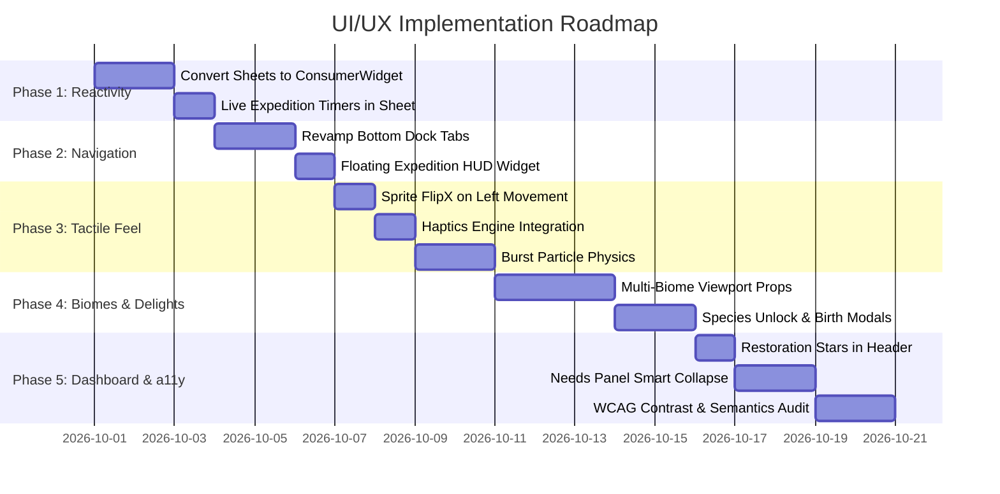

# Extinction Sanctuary — UI/UX Master Improvement Plan

**Document:** Authoritative UI/UX Architecture & Experience Enhancement Plan  
**Target File:** `plan/1-ui-ux-improvements.md`  
**Related Documents:** `plan/0-startup.md`, `VIEWPORT_FIX_PLAN.md`  
**Status:** Approved for Implementation  
**Estimated Sprints:** 4 Phased Milestones  

---

## 1. Executive Summary & Problem Statement

Extinction Sanctuary has established a solid numerical engine, deterministic offline simulation, and multi-habitat concurrency. However, the user experience currently exhibits three fundamental friction categories:

1. **State Reactivity Gaps:** Bottom sheets (`UpgradesSheet`, `ExpeditionsSheet`, `MissionsSheet`, etc.) receive static snapshots of `GameState` without subscribing to Riverpod updates. Players experience frozen timers, unresponsive claim buttons, and unrefreshed balances.
2. **Information Architecture Friction:** Core engagement loops (Expeditions, Missions, World Map, Prestige) are buried inside an obscure top-header pill (`🛰️ Operations`), while the main navigation dock is dominated by low-frequency or static tabs.
3. **Lack of Idle Game "Juice" & Immersion:** Visual feedback is minimal (animals walk backwards when heading left, haptics are completely absent, celebrations on unlocks/births do not exist, and all biomes render identical green farm props).

This document details the engineering specifications, UI components, interaction designs, and implementation steps required to transform Extinction Sanctuary into a tactile, responsive, and visually rewarding idle conservation game.

---

## 2. High-Level Architecture & Component Map

```
┌─────────────────────────────────────────────────────────────────┐
│                       SanctuaryScreen                           │
│  ┌───────────────────────────────────────────────────────────┐  │
│  │ Enhanced CurrencyHeader (Credits, DNA, Research, Stars ⭐) │  │
│  └───────────────────────────────────────────────────────────┘  │
│  ┌───────────────────────────────────────────────────────────┐  │
│  │ Habitat Header + Active Expedition HUD Tracker            │  │
│  └───────────────────────────────────────────────────────────┘  │
│  ┌───────────────────────────────────────────────────────────┐  │
│  │ Living Habitat Viewport (Biome Props, FlipX, Particles)   │  │
│  └───────────────────────────────────────────────────────────┘  │
│  ┌───────────────────────────────────────────────────────────┐  │
│  │ Adaptive Needs Panel (Dynamic Species, Smart Collapse)    │  │
│  └───────────────────────────────────────────────────────────┘  │
│  ┌───────────────────────────────────────────────────────────┐  │
│  │ Reactive 5-Tab Navigation Dock                            │  │
│  │ [🏝️ Reserve] [🧭 Expeditions] [🎯 Missions] [⭐ Tech] [🌎 Map]│  │
│  └───────────────────────────────────────────────────────────┘  │
└─────────────────────────────────────────────────────────────────┘
```

---

## 3. Phase Breakdown & Engineering Specifications

### Phase 1: Reactive Modal Sheets & State Subscription (P0)

#### 1.1 Root Cause & Solution
All sheets (`UpgradesSheet`, `ExpeditionsSheet`, `ResearchSheet`, `MissionsSheet`, `StaffSheet`, `WorldMapSheet`, `RestorationModal`) are currently `StatelessWidget`s initialized with a static `final GameState state`.
- **Action:** Convert each modal/sheet to a `ConsumerWidget`.
- **Implementation:**
  ```dart
  class ExpeditionsSheet extends ConsumerWidget {
    const ExpeditionsSheet({super.key});

    @override
    Widget build(BuildContext context, WidgetRef ref) {
      final state = ref.watch(gameProvider);
      final controller = ref.read(gameProvider.notifier);
      final nowMs = DateTime.now().millisecondsSinceEpoch;
      // UI now rebuilds automatically on 1-second simulation ticks!
      ...
    }
  }
  ```
- **Files Modified:**
  - `lib/screens/expeditions_sheet.dart`
  - `lib/screens/upgrades_sheet.dart`
  - `lib/screens/research_sheet.dart`
  - `lib/screens/missions_sheet.dart`
  - `lib/screens/staff_sheet.dart`
  - `lib/screens/world_map_sheet.dart`
  - `lib/widgets/restoration_modal.dart`
  - `lib/screens/sanctuary_screen.dart` (update sheet launch calls to omit stale state arguments)

---

### Phase 2: Navigation & Information Architecture Overhaul (P1)

#### 2.1 Rebalancing the Bottom Navigation Dock
Reorganize the bottom dock to prioritize active core gameplay loops:

| Old Dock Tab | New Dock Tab | Route / Destination | Badge Condition |
| :--- | :--- | :--- | :--- |
| **Sanctuary** | **Reserve** (🏝️) | Focuses camera / active sanctuary viewport | None |
| **Upgrades** | **Expeditions** (🧭) | Opens `ExpeditionsSheet` | `any(e.isCompleted)` or active countdown pill |
| **Staff** | **Directives** (🎯) | Opens `MissionsSheet` | `any(m.isCompleted && !m.isClaimed)` |
| **Research** | **Operations** (⚙️/⭐) | Unified Upgrades, Research & Staff Hub | Affordable upgrades available |
| **Archive** | **World Map** (🌎) | Opens `WorldMapSheet` | New species ready to settle |

*(The Encyclopedia Archive and Staff rosters are accessible from within the unified Operations Hub or via a discreet secondary icon in the header).*

#### 2.2 Persistent Live Expedition HUD Tracker
Add a floating compact tracker widget pinned to the top of the viewport:
- When an expedition is active: shows a sleek floating pill (e.g., `🧭 Tasman Trail: 0:28` with a pulsing blue progress ring).
- When completed: turns emerald green with `🧭 EXPEDITION READY! [CLAIM]`.
- Tapping opens `ExpeditionsSheet` directly.

---

### Phase 3: "Juice", Tactile Feel & Viewport Micro-Interactions (P1)

#### 3.1 Directional Sprite Flipping (Fixing Moonwalking)
- **Problem:** When an animal walks left, `animal.left` only shifts horizontal position by 4px. The emoji faces right while sliding left.
- **Fix:** In `lib/widgets/habitat_viewport.dart`:
  ```dart
  Transform.scale(
    scaleX: animal.left ? -1.0 : 1.0,
    child: Text(
      species.iconEmoji,
      style: const TextStyle(fontSize: 28),
    ),
  )
  ```

#### 3.2 Haptic Feedback Integration
Inject system haptics across all primary interactions respecting `state.hapticsEnabled`:
- **Viewport Care Tap:** `HapticFeedback.lightImpact()`
- **Direct Animal Tap:** `HapticFeedback.mediumImpact()`
- **Upgrade / Research Purchase:** `HapticFeedback.mediumImpact()`
- **Expedition Claim / Species Birth:** `HapticFeedback.heavyImpact()`
- **Ecosystem Restoration (Prestige):** `HapticFeedback.vibrate()`

#### 3.3 Dynamic Particle System
Replace the linear vertical fade with radial burst physics:
- Particle class tracks `Offset velocity`, `double rotation`, and `double scale`.
- Tapping generates 2–3 particles bursting slightly outward in a fan trajectory.
- Heart particles (`❤️`) trigger on direct animal taps, while currency particles (`+🪙`, `+🧬`) burst on ground taps.

---

### Phase 4: Multi-Biome Visual Diversity & Progression Props (P2)

Currently, `_HabitatPainter` draws identical green tropical plants and a wooden barn across all biomes.

#### 4.1 Biome-Specific Canvas Sets
Refactor `_HabitatPainter` to render distinct environment props:

| Biome | Flora & Ground Props | Water Feature | Shelter / Nesting | Atmospheric Effects |
| :--- | :--- | :--- | :--- | :--- |
| **Tropical Island** (`dodo`) | Palm shrubs, tropical ferns, seashell clusters | Sandy shoreline pool | Bamboo thatched hut, soft moss nest | Golden fireflies |
| **Australian Forest** (`thylacine`) | Eucalyptus trunks, bracken fern gullies | Shaded creek bed | Hollowed log den, leaf litter bedding | Floating forest spores |
| **Northern Coast** (`great_auk`) | Sea-thrift, lichen rocks, kelp washed ashore | Deep ocean tide pool with foam | Granite cliff-crevice shelf | Saltwater mist motes |
| **African Grassland** (`quagga`) | Dry tall savannah grass, acacia bush | Sun-baked watering hole | Natural thorn thicket shade | Sunbeam dust particles |
| **Ice Age Tundra** (`mammoth`) | Frozen tundra lichen, snow mounds | Glacial melt pool with floating ice | Ice cavern shelter, bone framing | Drifting snowflakes |

#### 4.2 Upgrade-Driven Visual Progression
- Level 1: Basic natural clearing.
- Level 3 (`auto_water`): Fresh-flow stone/bamboo pump visible on water edge.
- Level 6 (`auto_feeder`): Solar-powered automated feeding silo replacing the bowl.
- Level 8+: Enhanced night illumination and animated fireflies/aurora.

---

### Phase 5: Milestone Celebrations & Reward Fanfare (P2)

#### 5.1 Species Birth & Hatching Fanfare
When an animal birth occurs (either natural timer completion or direct DNA revival):
- Display a floating celebration badge above the habitat: `🐣 New Dodo Hatched! (+0.4 🧬/s)`.
- Trigger a camera zoom pulse or heart particle burst on the newly born animal.

#### 5.2 New Species Genome Recovery Modal
When an expedition unlocks a previously extinct creature:
- Open a celebratory full-screen dialog:
  - Giant rotating species emoji with radial god rays.
  - Lore title: *"GENOME RESTORED: THYLACINE"*
  - Extinction date and historical region snippet.
  - Immediate action button: `[ Settle Tasmanian Forest Reserve ]`.

#### 5.3 Celestial Ecosystem Restoration (Prestige Ceremony)
- When resetting a reserve for Restoration Stars (⭐):
  - Screen flashes with radiant nature burst and green/gold particle swirl.
  - Stat summary displays total stars earned and new permanent multiplier bonuses.

---

### Phase 6: Dashboard & Needs Panel Ergonomics (P2)

#### 6.1 Top Currency Bar Enhancement
- Add Restoration Stars (`⭐`) into `CurrencyHeader` once prestige is unlocked (`state.restorationPoints > 0` or `timesRestored > 0`).
- Update live rate calculations (`+/s`) to sum production across **all active sanctuaries**, reflecting total sanctuary network output rather than just Dodo Island.

#### 6.2 Adaptive Needs Panel
- Replace hardcoded `"Dodo Population"` with `"${species.name} Population"`.
- Replace hardcoded `'🦤'` with `species.iconEmoji`.
- **Smart Collapse State:** When both `hasAutoFeeder` and `hasAutoWater` are true:
  - Automatically collapse the static 100% bars into two compact green chips (`🍏 Auto`, `💧 Auto`).
  - Reclaim ~80px of vertical space to expand the live habitat viewport.
  - Surface active sanctuary buttons: `[ 🧬 Revive (${cost} DNA) ]` and `[ ✨ Habitat Enrichment ]`.

---

### Phase 7: Accessibility (a11y) & Visual Ergonomics (P3)

1. **WCAG AA Contrast Compliance:**
   - Elevate muted micro-text from `#64748B` to `#94A3B8` (4.8:1 contrast on dark surface `#0C141D`).
   - Increase subtitle brightness from `Colors.white24` to `Colors.white60`.
2. **Touch Targets:**
   - Enforce minimum `48x48dp` tap targets for sound toggle, mission claims, and bottom dock buttons.
3. **Screen Reader Semantics:**
   - Wrap icon-only indicators with `Semantics`:
     ```dart
     Semantics(
       label: 'Credits: ${state.credits.toStringAsFixed(0)}',
       child: Text('🪙 ...'),
     )
     ```
   - Provide an accessible label on `HabitatViewport`: `"Habitat Viewport: 8 Woolly Mammoths roaming the Ice Age Tundra. Double tap to care for animals."`.

---

### Phase 8: Responsive Layout & Small Screen Protection (P3)

1. **Short Screen Fallback (< 650dp height):**
   - Use `LayoutBuilder` inside `SanctuaryScreen`.
   - On compact screens, condense `CurrencyHeader` and `HabitatHeader` vertical padding from `8` to `4`.
   - Prevent any viewport collapse below `180dp`.
2. **Tablet & Landscape Mode:**
   - On screens wider than `720dp`: Split into a dual-pane layout:
     - Left (60%): Habitat Viewport, Biome Header, and Floating Animal Controls.
     - Right (40%): Currency Dashboard, Needs Panel, and Docked Operations Panes.

---

## 4. Implementation Schedule & Verification Plan



### Automated Verification Protocols
- **Widget Tests:**
  - Verify `ExpeditionsSheet` rebuilds and advances timers across periodic pump intervals.
  - Verify `HabitatViewport` mirrors emoji text horizontally when `animal.left == true`.
  - Verify `NeedsPanel` displays `Thylacine` name and `🐺` emoji when passed a Tasmanian forest habitat.
  - Verify `CurrencyHeader` calculates cumulative rates across multiple populated habitats.
- **Static Analysis:**
  - Zero warnings via `flutter analyze`.
- **Accessibility Audits:**
  - Validate contrast ratios and semantics using Flutter WidgetTester accessibility guidelines.
